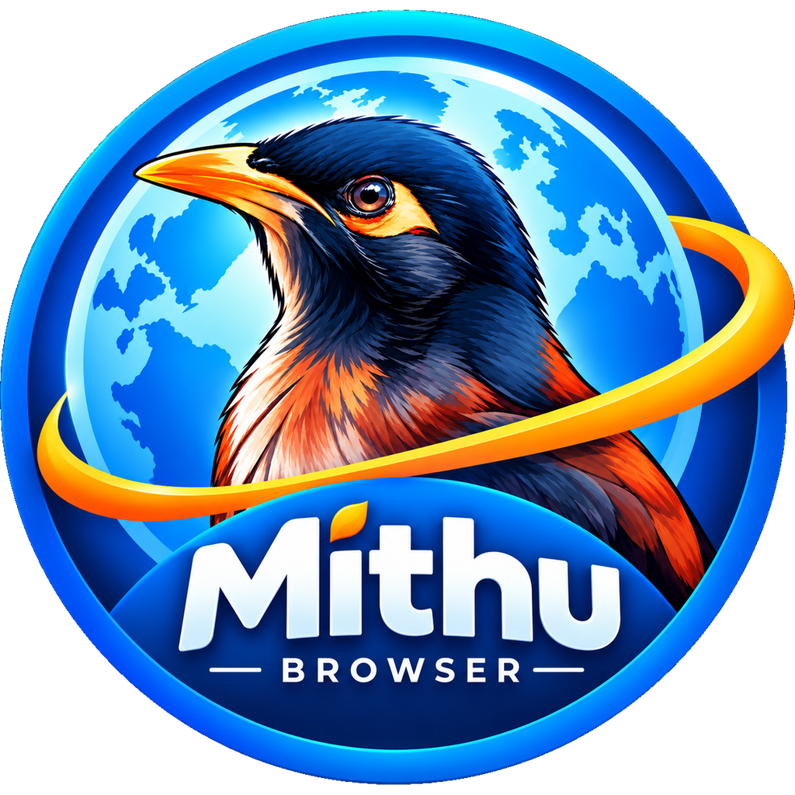
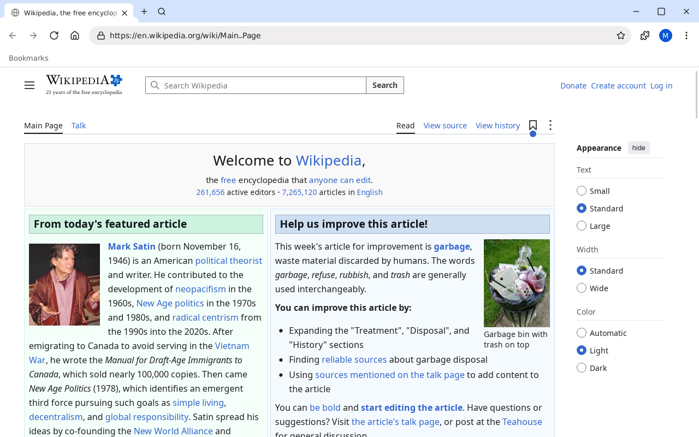
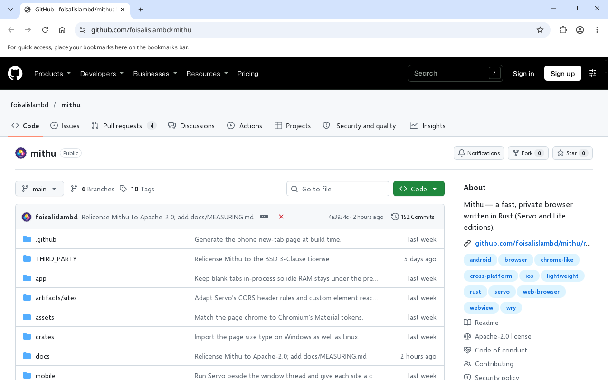
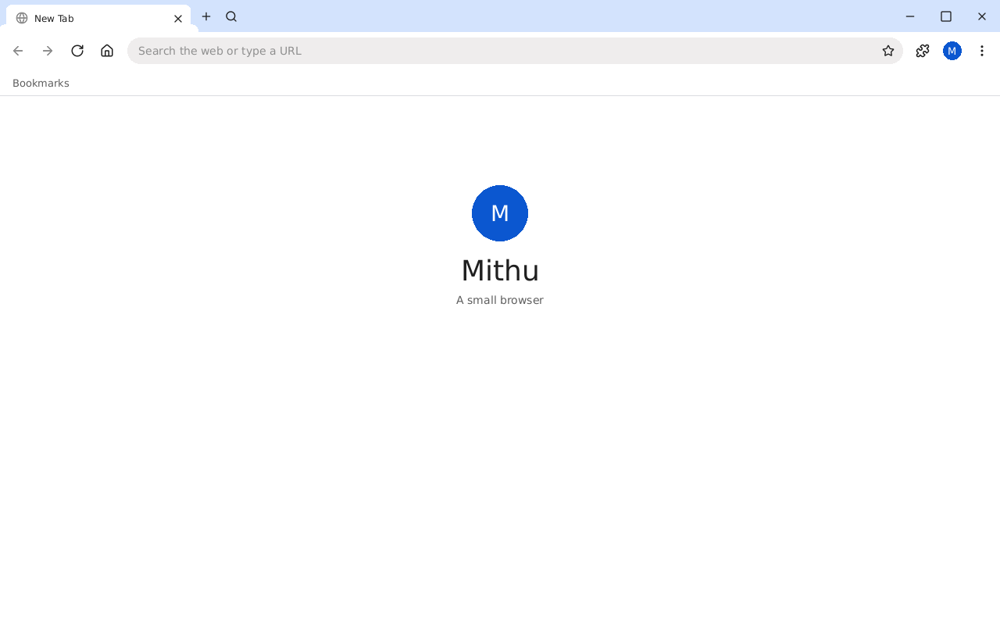
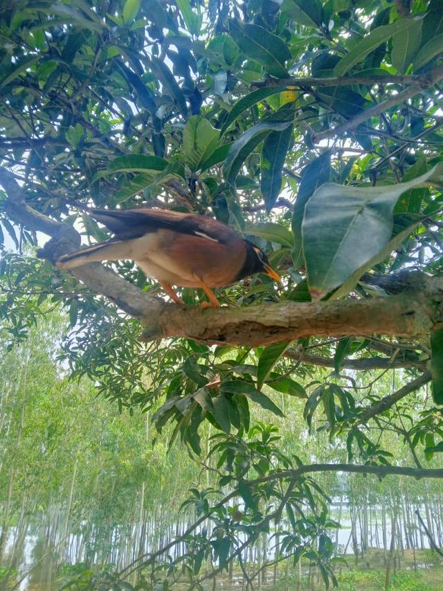
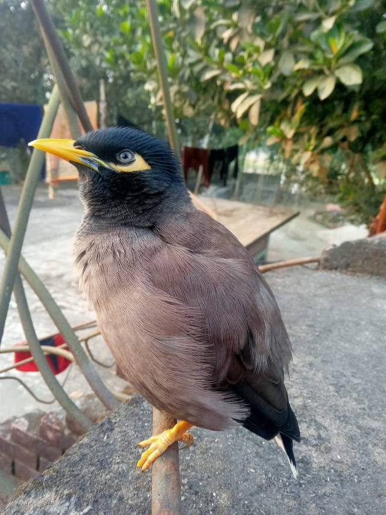
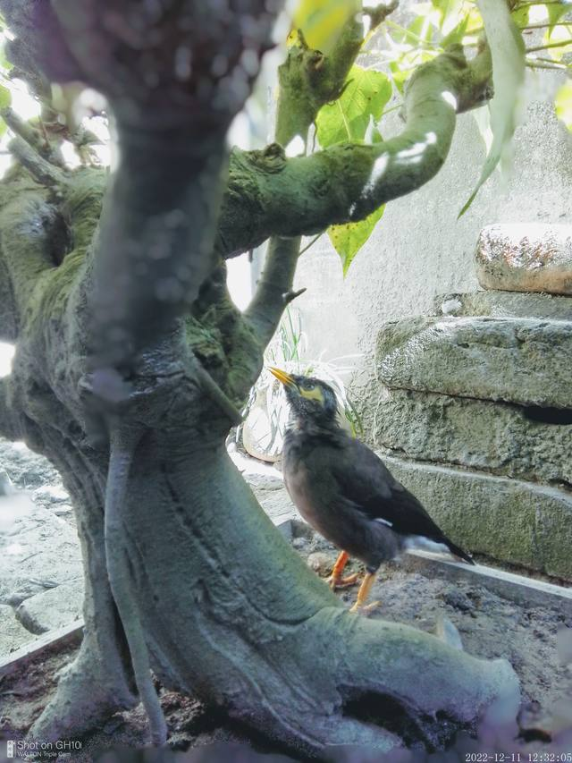
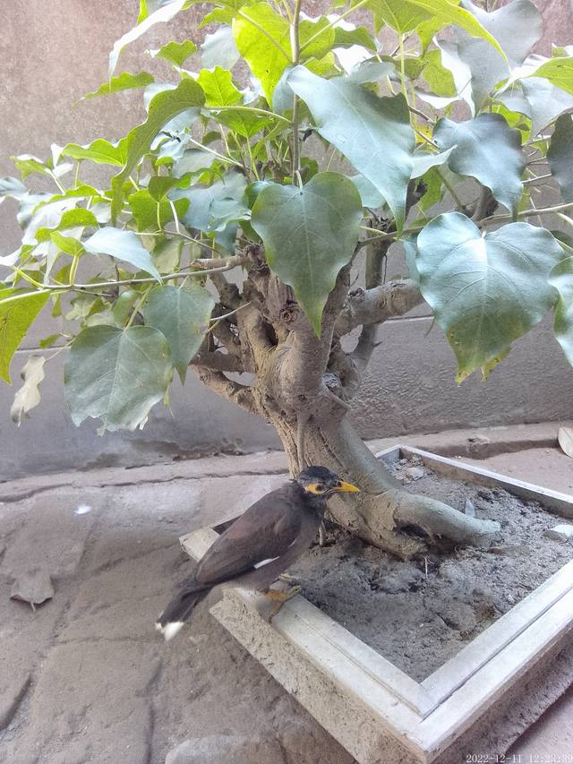

<p align="center">
  
</p>

<h1 align="center">Mithu</h1>

<p align="center">A small, light browser. Two editions, one frame, and a name that belongs to a real bird.</p>

<p align="center">
  <a href="https://github.com/foisalislambd/mithu/releases"></a>
  <a href="https://github.com/foisalislambd/mithu/actions/workflows/ci.yml"></a>
  <a href="LICENSE"></a>
  <a href="https://github.com/foisalislambd/mithu/releases"></a>
</p>

<p align="center">[](VERSION.md)</p>

<p align="center">
  
</p>

<p align="center"><em>Mithu Lite on English Wikipedia, 1280×800, Linux. The mark in the frame is Mithu's.</em></p>

## Features

<table>
  <tr>
    <td width="33%" valign="top"><strong>One frame</strong><br>Tabs, toolbar, address bar, bookmarks, and status bubble are shared by both editions.</td>
    <td width="33%" valign="top"><strong>Your pages</strong><br>Settings, history, downloads, bookmarks, and the new tab live at <code>mithu://</code> and stay on this computer.</td>
    <td width="33%" valign="top"><strong>Own mark</strong><br>A myna, a blue globe, and an orange ring. No other browser's name or logo.</td>
  </tr>
  <tr>
    <td valign="top"><strong>Sharp at any scale</strong><br>The frame snaps to whole pixels at 100%, 125%, 150%, and 200%.</td>
    <td valign="top"><strong>Search you choose</strong><br>The address bar uses DuckDuckGo, Bing, or Wikipedia. A hostname opens as HTTPS.</td>
    <td valign="top"><strong>Light or dark</strong><br>Theme, font size, zoom, the home button, and the bookmarks bar are saved and applied.</td>
  </tr>
</table>

Keyboard: Enter submits the address bar. Alt+Left and Alt+Right walk history. Ctrl+L focuses the address bar, Ctrl+R reloads, Ctrl+T opens a tab, Ctrl+W closes one, Ctrl+Tab cycles tabs, Ctrl+F finds in the page, Ctrl+B toggles the bookmarks bar, Ctrl+D bookmarks the page, Ctrl+H opens history, Ctrl+J opens downloads.

## Editions

| | Mithu | Mithu Lite |
| --- | --- | --- |
| Binary | `mithu` | `mithu-lite` |
| Engine | [Servo](https://github.com/servo/servo), linked from `third_party/servo` | The OS web view through [`wry`](https://github.com/tauri-apps/wry): WebKitGTK, WKWebView, or WebView2 |
| Disk | about 96 MB | about 5 MB |
| about:blank RAM | 361 MB RSS, one process | UI about 353 MB RSS, plus WebKit's web and network processes |
| Choose it when | You want Servo in-process | You want a small binary and today's sites |
| Build | Compiles Servo. The submodule is required | Does not compile Servo. The submodule still has to be on disk so Cargo can resolve the workspace |

Numbers are from Linux x86_64 release builds (`opt-level = "z"`, thin LTO, stripped). Lite load times on that machine: example.com 846 ms, English Wikipedia 1.1–1.4 s, GitHub 2.0–2.1 s, YouTube's logged-out home 3.5 s, BBC 1.2 s.

`mithu-windows-x64.zip` holds `mithu.exe`, the Visual C++ runtime DLLs it links (`VCRUNTIME140.dll`, `VCRUNTIME140_1.dll`, `MSVCP140.dll`), ANGLE (`libEGL.dll` and `libGLESv2.dll`), and a short readme. The page is drawn through ANGLE, because raw WGL needs `WGL_NV_DX_interop`. Set `ANGLE_DEFAULT_PLATFORM=warp` for software rendering. The release builds of `mithu.exe` and `mithu-lite.exe` are Windows GUI programs, so opening one does not create a terminal. `--version` and `--smoke-test` still print when you start them from a console. A fatal error is appended to `%LOCALAPPDATA%\Mithu\mithu.log` and shown in a message box. Unzip the folder and run `mithu.exe` from that folder. Servo's resources are compiled into the executable. Check a download with `sha256sum -c SHA256SUMS` from the release directory (on Windows, `Get-FileHash`).

## Screenshots

<p align="center">
  
  
</p>
<p align="center">
  
  
</p>

<p align="center"><em>Same frame. Servo still drops some images on Wikipedia.</em></p>

## The story of Mithu

Mithu was a common myna — a শালিক, *Acridotheres tristis* — who lived with the family this browser is named for. Black head, yellow beak, a yellow patch around the eye, brown body, white patches in the wings. He was very tame. He sat on their hands.

The family kept six or seven mynas, all of them শালিক পাখি. They raised Mithu for a long time before anything went wrong.

One day, flying upward, he hit the ceiling fan while it was running at full speed, and he fell. The family thought he would die. Within a few days the feathers on his head fell off where he had been hit. The cut was bad. They cared for him a great deal, and he recovered. After that he lived on with them for a long while.

Then one day he left on his own, and they never found him again. The other mynas left too, in time. None of the six or seven are with the family now. Of all of them, Mithu's story is the one closest to their hearts.

The browser carries his name: small, light, resilient, and free.

### মিঠুর গল্প

মিঠু একটা শালিক পাখি — common myna, *Acridotheres tristis*। কালো মাথা, হলুদ ঠোঁট, চোখের চারপাশে হলুদ ছোপ, বাদামি গা, ডানায় সাদা দাগ। খুবই পোষ মেনেছিল, তাদের হাতে এসে বসত।

পরিবারে মোট ৬-৭টা শালিক পাখি ছিল। ফ্যানের দুর্ঘটনার অনেক আগে থেকেই তারা মিঠুকে লালনপালন করেছে।

একদিন উপরের দিকে উড়তে গিয়ে সে পুরো বেগে ঘুরতে থাকা সিলিং ফ্যানে ধাক্কা খেয়ে পড়ে যায়। সবাই ভেবেছিল সে আর বাঁচবে না। কয়েকদিনের মধ্যে আঘাতের জায়গায় মাথার পালক ঝরে যায়। কাটা জায়গাটা খুব খারাপ ছিল। অনেক যত্ন করে তারা তাকে সুস্থ করে তোলে। তারপরও সে আরও অনেকদিন তাদের সঙ্গে ছিল।

একদিন সে নিজে থেকেই চলে যায়, আর তাকে আর খুঁজে পাওয়া যায়নি। বাকি শালিকগুলোও এক এক করে উড়ে যায়। ৬-৭টা পাখির একটাও এখন তাদের কাছে নেই। তবু সবগুলোর মধ্যে মিঠুর গল্পটাই তাদের হৃদয়ের সবচেয়ে কাছে।

এই ব্রাউজার তার নাম বয়ে চলে — ছোট, হালকা, দৃঢ়, মুক্ত।

<table>
  <tr>
    <td width="160" align="center"><br><sub>In a tree</sub></td>
    <td width="160" align="center"><br><sub>Black head, yellow beak</sub></td>
    <td width="160" align="center"><br><sub>Beak and eye-patch</sub></td>
    <td width="160" align="center"><br><sub>On a hand</sub></td>
  </tr>
  <tr>
    <td width="160" align="center"><br><sub>December 2022</sub></td>
    <td width="160" align="center"><br><sub>After the injury</sub></td>
    <td width="160" align="center"><br><sub>December 2022</sub></td>
    <td width="160"></td>
  </tr>
</table>

Photos 5 and 7 carry a December 2022 date from the camera. Photo 6 is his head after the fan injury.

## Download

Published files are on [GitHub Releases](https://github.com/foisalislambd/mithu/releases). The newest published tag is [v0.1.1](https://github.com/foisalislambd/mithu/releases/tag/v0.1.1). Each release includes `SHA256SUMS`.

| Platform | Mithu | Mithu Lite |
| --- | --- | --- |
| Linux x86_64 | `mithu-linux-x64` | `mithu-lite-linux-x64` |
| macOS | `mithu-macos` | `mithu-lite-macos` |
| Windows x64 | `mithu-windows-x64.zip` | `mithu-lite-windows-x64.exe` |

Check a download from the release directory:

```bash
sha256sum -c SHA256SUMS
```

On Windows: `Get-FileHash`. The v0.1.1 sums are:

```text
6bf7c6022f56d37cc4f92da877c50ca9db3fa505b4985bef824f0f0d0636c278  mithu-linux-x64
dffd7f4631537234fddb8c661844b9c7ceeeabfeaca2604c3a66c66914d93427  mithu-lite-linux-x64
bab86083e89ec02669db85e8adabde345b53479574e47566f3cb60da780cf6c2  mithu-lite-macos
91d258ae449a57d42d61887bed2055a655cf0330cb5cddb6fa89e7b708b65e71  mithu-lite-windows-x64.exe
814dc0bc6a1c491e0a98d09c89ae07b742d70d69f8925d7a1c477f7475d1d9d0  mithu-macos
44b8b8514b731d02e8e0ead781180e11dd3777a800fc2fe93aaa507d47f758c3  mithu-windows-x64.zip
```

`mithu-windows-x64.zip` holds `mithu.exe`, the Visual C++ runtime DLLs it links, ANGLE (`libEGL.dll` and `libGLESv2.dll`), and a short readme. Unzip the folder and run `mithu.exe` from that folder. The binaries are not code-signed. Windows SmartScreen warns on a new unsigned download because of Mark-of-the-Web, not because a scanner found a payload.

Mark the Linux and macOS files executable (`chmod +x`). On Linux, Lite needs WebKitGTK 4.1 (`libwebkit2gtk-4.1-0`) and `GDK_BACKEND=x11`. Windows Lite needs the WebView2 runtime, which current Windows already includes. If the Windows window closes at once, the reason is in `%LOCALAPPDATA%\Mithu\mithu.log`.

## Build

Rust stable is pinned in `rust-toolchain.toml`.

**Lite, Linux:** `libwebkit2gtk-4.1-dev`, `libgtk-3-dev`, `libsoup-3.0-dev`. Run with `GDK_BACKEND=x11`.

**Full Mithu, Linux**, also needs Servo's libraries:

```bash
sudo apt-get install -y build-essential cmake pkg-config python3 gperf \
  libclang-dev libssl-dev libfontconfig1-dev libfreetype-dev \
  libglib2.0-dev libgtk-3-dev libunwind-dev \
  gstreamer1.0-plugins-good libgstreamer1.0-dev libgstreamer-plugins-base1.0-dev
```

macOS needs Xcode Command Line Tools. Windows needs Visual Studio C++. Full Mithu on Windows also needs the toolchain Servo documents after the submodule is present.

```bash
git clone --depth 1 https://github.com/foisalislambd/mithu.git
cd mithu
git submodule update --init --depth 1 third_party/servo

cargo run -p mithu-lite
cargo run -p mithu
tools/package.sh lite
tools/package.sh full
cargo test --workspace
```

`tools/package.sh` runs `tools/version.py sync` first, so the binaries follow `VERSION.md`.

## Mobile

Mithu Lite is the edition meant for phones. The app id is `org.mithu.lite`. Android adaptive icons and an iOS AppIcon set, using the same mark, are in `assets/android`, `assets/android-lite`, and `assets/ios`. The phone projects are not in this tree yet, and there is no iOS Servo build. Desktop Linux, macOS, and Windows are what the releases ship.

Linux desktop entries and hicolor icons are in `assets/linux`. macOS `.icns` files and Windows `.ico` files are in `assets/brand`. A Windows release build embeds the `.ico` in the exe.

## Project structure

| Path | What it is |
| --- | --- |
| `crates/ui` | Shared frame, `mithu://` pages, and the mark |
| `crates/text` | Noto Sans and Noto Sans Bengali, drawn in the frame |
| `crates/shell` | Servo tabs under that frame |
| `app/mithu` | Full window |
| `app/mithu-lite` | Lite window, one OS web view per tab |
| `third_party/servo` | Servo submodule. Not compiled into Lite |
| `VERSION.md` | The only version to edit |

## Releases

The version is the first line of [VERSION.md](VERSION.md). Right now that line is `0.1.4`. That file is the only place to change it.

`python3 tools/version.py sync` copies the line into `[workspace.package] version`, the workspace packages in `Cargo.lock`, the badge at the top of this file, and, when those projects are in the tree, Android `versionName` / `versionCode` and iOS `CFBundleShortVersionString`, `CFBundleVersion`, `MARKETING_VERSION`, and `CURRENT_PROJECT_VERSION`. The numeric code is `major * 1000000 + minor * 1000 + patch` (0.1.1 is 1001). `python3 tools/version.py check` prints any files that still differ and exits 0.

Pushing `main` publishes a GitHub Release only when that version is strictly greater than the newest `v*` tag. Each build runs `sync` before compiling. v0.1.2 is the Windows-console release already on main. This line is 0.1.3, so it publishes only after that tag exists.

## Roadmap

1. Broader Servo page fidelity.
2. A real download path for the full build, once libservo exposes one.
3. Lite on Wayland.
4. Mithu Lite on Android and iOS, on the system web view. No iOS Servo.
5. Menus, dialogs, and settings laid out the way a familiar desktop browser is, with Mithu's own mark and no other company's services.

[docs/ROADMAP.md](docs/ROADMAP.md) is the older note from the in-tree engine. [docs/ARCHITECTURE.md](docs/ARCHITECTURE.md) describes the Servo shell.

## Contributing

Issues and pull requests go to [github.com/foisalislambd/mithu](https://github.com/foisalislambd/mithu). Read [CONTRIBUTING.md](CONTRIBUTING.md) and [CODE_OF_CONDUCT.md](CODE_OF_CONDUCT.md). Report a security problem through [SECURITY.md](SECURITY.md).

The interface stays in English. The story above is also told in Bengali. Workspace crates forbid `unsafe` code, except `crates/host`, which is the Win32 console attach. Do not weaken TLS hostname checks.

## License

[MIT](LICENSE). Copyright 2026 Mithu contributors.

`third_party/servo` is [Servo](https://github.com/servo/servo), MPL-2.0. [THIRD_PARTY/NOTICE](THIRD_PARTY/NOTICE) lists it. Toolbar glyphs are Lucide (ISC). The text is in [THIRD_PARTY/lucide-LICENSE](THIRD_PARTY/lucide-LICENSE). The bird photographs and the logo are the maintainer's.
