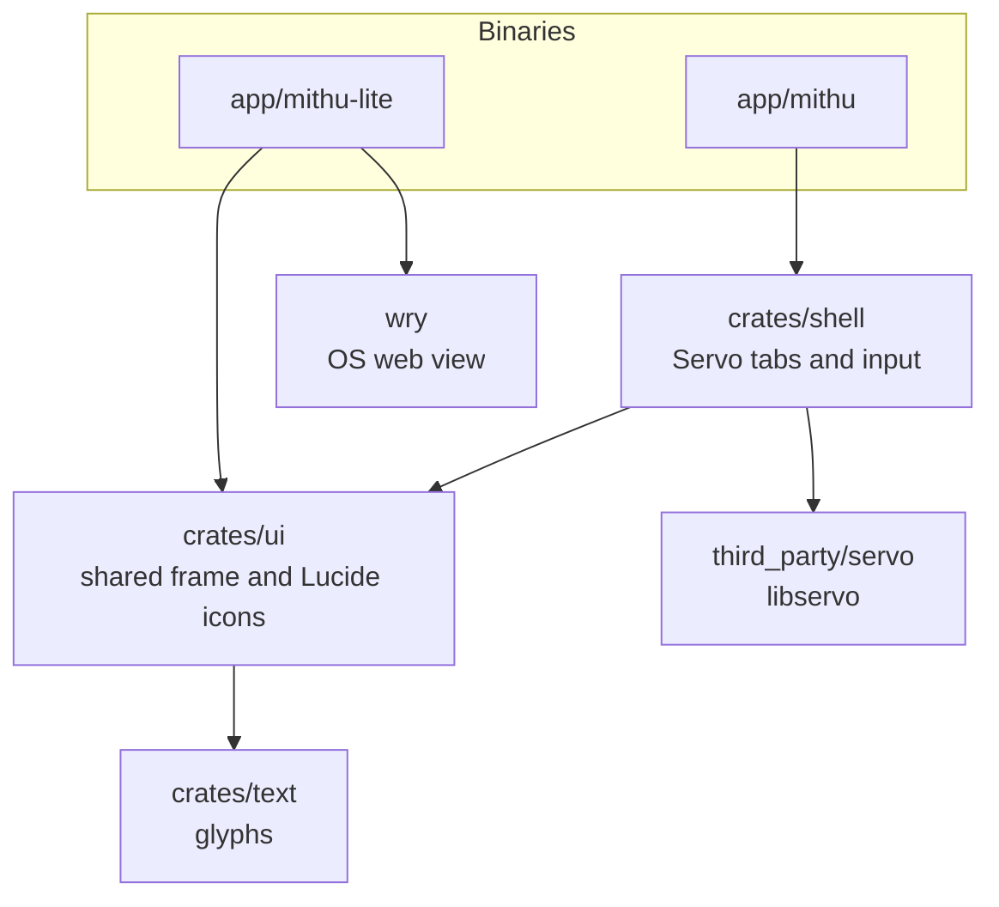
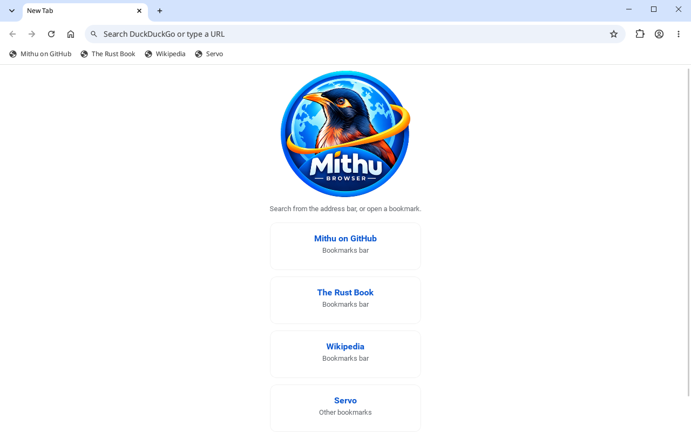

# Mithu

A small Rust browser with a familiar desktop frame, in two editions: one embeds [Servo](https://github.com/servo/servo), the other uses the operating system's web view.

[](LICENSE)
[](VERSION.md)
[](https://github.com/foisalislambd/mithu/releases)

<p align="center">
  
</p>

<p align="center"><em>Mithu Lite on English Wikipedia, 1280×800, Linux. The mark in the frame is Mithu's. There is no Google or Chrome logo.</em></p>

## Contents

- [What Mithu is](#what-mithu-is)
- [Two editions](#two-editions)
- [Features](#features)
- [Limitations](#limitations)
- [Download](#download)
- [Build from source](#build-from-source)
- [Project structure](#project-structure)
- [Releases](#releases)
- [Contributing](#contributing)
- [Roadmap](#roadmap)
- [License](#license)

## What Mithu is

Mithu is a lightweight browser written in Rust, in this repository. The name is for a rose-ringed parakeet who lived with a family and died a long time ago.

The goal is a thin desktop shell, not a second product stacked on top of the page. There is no bundled assistant and no ad system. Both editions draw the same frame: tab strip, toolbar, address bar, bookmarks bar, status bubble, and a new-tab page that says Mithu. Pages are drawn by one of two engines, and you pick the engine by choosing which binary you run.

[@foisalislambd](https://github.com/foisalislambd) maintains it. The source is at [github.com/foisalislambd/mithu](https://github.com/foisalislambd/mithu).

## Two editions

| | Mithu (full) | Mithu Lite |
| --- | --- | --- |
| Binary | `mithu` | `mithu-lite` |
| Engine | Servo, linked from `third_party/servo` (`components/servo`, libservo) | The OS web view through [`wry`](https://github.com/tauri-apps/wry): WebKitGTK on Linux, WKWebView on macOS, WebView2 on Windows |
| Binary size | ~96 MB (96,881,800 bytes) | 5.1 MiB (5,338,536 bytes) |
| about:blank RAM | 361 MB RSS, one process | UI process about 353 MB RSS (steady 361,468 KB). WebKit also starts a web process (~133 MB RSS) and a network process (~52 MB RSS). Together, proportional set is about 387 MB |
| Use it when | You want Servo in-process and a build that does not depend on the system web view | You want a small binary and today's sites, using the engine the OS already ships |
| Build cost | Compiles Servo. Slow, and the submodule is required | Does not compile Servo or mozjs. The submodule still has to be checked out, because Cargo resolves the whole workspace |

Numbers above were measured on Linux x86_64 from release builds (`opt-level = "z"`, thin LTO, stripped). Lite load times on that machine, from navigation to the engine's finished event: example.com 846 ms, English Wikipedia 1.1–1.4 s, GitHub 2.0–2.1 s, YouTube's logged-out home 3.5 s, BBC 1.2 s.

Wikipedia in Lite, with the helper processes included, was about 633 MB RSS and 474 MB PSS. Lite is much smaller on disk. On Linux it is not lighter in RAM than the Servo build, because WebKitGTK's own processes are large.

## Features

Both editions share the frame from `crates/ui`:

- Rounded tabs, a close button, a new-tab button, and tab search.
- Back, forward, reload, and home. While a page is loading, reload becomes stop.
- An address bar. A hostname without a scheme opens as HTTPS. Other text is a DuckDuckGo search. Nothing is sent to a Google host by the bar itself.
- A lock or site-info chip, a bookmark star, an extensions button, a profile avatar marked "M", and a menu.
- A bookmarks bar and a status bubble for link hover and loading.
- A new-tab page with the Mithu wordmark.
- Lucide icons (ISC), drawn by Mithu. No Google or Chrome logo.

Keyboard: Enter submits the address bar. Alt+Left and Alt+Right walk history. Ctrl+L focuses the address bar, Ctrl+R reloads, Ctrl+T opens a tab, Ctrl+W closes one, Ctrl+Tab cycles tabs, Ctrl+F finds in the page, Ctrl+B toggles the bookmarks bar, Ctrl+D bookmarks the page, Ctrl+H opens history, Ctrl+J opens downloads.

Mithu Lite keeps one system web view per tab. Back, forward, and reload call `wry`. Downloads are written to the user's Downloads folder when the engine reports one.

The full build keeps one Servo `WebView` per tab and copies Servo's software framebuffer into the content area under the frame.

## Limitations

These are the gaps that are real today.

**Both**

- Android is not wired up.
- The extensions button opens a panel that says nothing is installed. There is no extension API.
- [docs/ROADMAP.md](docs/ROADMAP.md) still describes an earlier in-tree engine (Boa, a custom HTML pipeline). That pipeline has been removed. The page engines now are Servo and the OS web view.

**Mithu (full, Servo)**

- Servo does not yet paint every site the way a current browser does. On the English Wikipedia shot below, some images are missing and show as black boxes.
- libservo does not expose a download callback, so the full build lists downloads in the chrome and does not save the files.
- The window, the frame, and Servo share one process.

**Mithu Lite**

- `wry` has back, forward, and reload, and no stop method. Stop runs `window.stop()` in the page.
- On Linux the frame and WebKit share one X11 window. Start Lite with `GDK_BACKEND=x11`. Wayland is refused on purpose.
- Tab icons are not filled from the page; `wry` is not asked for a favicon bitmap.
- YouTube's logged-out home loads. Playing video needs GStreamer plugins (`fakevideosink` was missing on the measurement machine).
- GitHub's front page can finish its load event before the hero has painted. Give it a few seconds.

## Download

Release files are attached to [GitHub Releases](https://github.com/foisalislambd/mithu/releases) when a version is published. Nothing is published until `VERSION.md` is greater than the newest `v*` tag and the workflow on `main` succeeds. Until that first release, build from source.

Each release has these files, plus `SHA256SUMS`:

| Platform | Full (Servo) | Lite |
| --- | --- | --- |
| Linux x86_64 | `mithu-linux-x64` | `mithu-lite-linux-x64` |
| macOS | `mithu-macos` | `mithu-lite-macos` |
| Windows x64 | `mithu-windows-x64.zip` | `mithu-lite-windows-x64.exe` |

`mithu-windows-x64.zip` holds `mithu.exe`, the Visual C++ runtime DLLs it links (`VCRUNTIME140.dll`, `VCRUNTIME140_1.dll`, `MSVCP140.dll`), ANGLE (`libEGL.dll` and `libGLESv2.dll`), and a short readme. The page is drawn through ANGLE, because raw WGL needs `WGL_NV_DX_interop`. Set `ANGLE_DEFAULT_PLATFORM=warp` for software rendering. Unzip the folder and run `mithu.exe` from that folder. Servo's resources are compiled into the executable. Check a download with `sha256sum -c SHA256SUMS` from the release directory (on Windows, `Get-FileHash`).

The binaries are not code-signed. Windows SmartScreen and Defender warn on an unsigned program downloaded from the internet because the file is new and carries a Mark-of-the-Web, not because a scanner found a payload. Signing later needs an Authenticode certificate for Windows and an Apple Developer ID plus notarization for macOS, stored as GitHub Actions secrets. Those secrets are not in this repository, so the release stays unsigned.

Mark the Linux and macOS files executable (`chmod +x`) and run them. On Linux, Lite still needs WebKitGTK 4.1 at runtime (`libwebkit2gtk-4.1-0`) and `GDK_BACKEND=x11`. Windows Lite needs the WebView2 runtime, which current Windows already includes. The full binary does not need WebKit. If the Windows window closes at once, the reason is in `%LOCALAPPDATA%\Mithu\mithu.log`.

The tab strip, address bar, and new-tab page are drawn with Noto Sans and Noto Sans Bengali embedded in the binary (SIL Open Font License, see `crates/text/fonts/OFL.txt`). System fonts are used only for characters those faces do not cover.

## Build from source

Rust stable is pinned in `rust-toolchain.toml`. Install it with [rustup](https://rustup.rs/).

### Prerequisites

**Mithu Lite**

| OS | What you need |
| --- | --- |
| Linux | `libwebkit2gtk-4.1-dev`, `libgtk-3-dev`, `libsoup-3.0-dev`. Run under X11: `GDK_BACKEND=x11`. |
| macOS | Xcode Command Line Tools. The page view is WKWebView, which ships with the OS. |
| Windows | A C++ build toolchain (Visual Studio Build Tools) and the WebView2 runtime. |

**Full Mithu** also needs the Servo submodule and Servo's native libraries. On Linux the release workflow installs:

```bash
sudo apt-get install -y build-essential cmake pkg-config python3 gperf \
  libclang-dev libssl-dev libfontconfig1-dev libfreetype-dev \
  libglib2.0-dev libgtk-3-dev libunwind-dev \
  gstreamer1.0-plugins-good libgstreamer1.0-dev libgstreamer-plugins-base1.0-dev
```

On macOS and Windows, install the toolchain Servo documents in `third_party/servo` after the submodule is present (Xcode on macOS, Visual Studio C++ on Windows). Do not expect `cargo build -p mithu` to finish without those.

### Clone

Use a depth-1 clone, then initialize the Servo submodule. Lite does not compile Servo, but `mithu-shell` is still a workspace member and its `servo` path must exist or Cargo stops before building anything.

```bash
git clone --depth 1 https://github.com/foisalislambd/mithu.git
cd mithu
git submodule update --init --depth 1 third_party/servo
```

### Build and run

```bash
# Lite. Does not compile Servo. The submodule must still be present.
cargo run -p mithu-lite
cargo run -p mithu-lite -- https://example.com/
cargo build -p mithu-lite --release

# Full. Requires the submodule.
cargo run -p mithu
cargo run -p mithu -- https://example.com/
cargo run -p mithu -- --screenshot frame.png https://example.com/

# Release binaries. tools/package.sh copies VERSION.md into Cargo.toml first.
tools/package.sh lite
tools/package.sh full
tools/package.sh both

cargo test --workspace
```

`tools/package.sh` writes `target/release/mithu-lite` and `target/release/mithu`. Pass a URL as the first argument to open it. In the window, type in the address bar and press Enter.

Lite measurement flags, both at 1280×800: `mithu-lite --screenshot out.png URL` and `mithu-lite --hold SECONDS URL`. `--hold` prints `load_ms` and `rss_kb`.

## Project structure



| Path | Package | What it is |
| --- | --- | --- |
| `crates/ui` | `mithu-ui` | Shared frame, icons, and address-bar parsing. No engine. |
| `crates/text` | `mithu-text` | Fonts and glyph measurement for the frame. |
| `crates/shell` | `mithu-shell` | Servo web views, history, and compositing under the frame. |
| `app/mithu` | `mithu` | Full window (`winit` and `softbuffer`). |
| `app/mithu-lite` | `mithu-lite` | Lite window. One `wry` web view per tab. |
| `third_party/servo` | `servo` | Servo submodule. Not compiled into Lite. Required on disk so the workspace resolves. |
| `tools/package.sh` | | Builds `lite`, `full`, or `both`. |
| `tools/version.py` | | Copies `VERSION.md` into Cargo, the lockfile, and mobile manifests (`sync`). |
| `VERSION.md` | | The only version to edit. The first line is semver. |
| `.github/workflows/release.yml` | | Builds both editions and publishes a release when the version increased. |
| `docs/` | | Architecture notes, the older roadmap, and screenshots. |

Package names use a `mithu-` prefix. `[workspace.package] version` is copied from `VERSION.md` by `tools/version.py sync`.

<p align="center">
  
  
</p>
<p align="center">
  
  
</p>

<p align="center"><em>Full Mithu (Servo) on Wikipedia and its new-tab page, beside Lite on GitHub and its new-tab page. Same frame. Wikipedia under Servo still drops some images.</em></p>

## Releases

The version is the first line of [VERSION.md](VERSION.md). Right now that line is `0.1.1`. That file is the only place to change it.

`python3 tools/version.py sync` copies the line into `[workspace.package] version`, the workspace packages in `Cargo.lock`, the badge at the top of this file, and, when those projects are in the tree, Android `versionName` / `versionCode` and iOS `CFBundleShortVersionString`, `CFBundleVersion`, `MARKETING_VERSION`, and `CURRENT_PROJECT_VERSION`. The numeric code is `major * 1000000 + minor * 1000 + patch` (0.1.1 is 1001). Prerelease text stays in the version name and is left out of the code. `python3 tools/version.py check` prints any files that still differ and exits 0, so a stale `Cargo.toml` does not block a release.

1. Change the first line of `VERSION.md`.
2. Push to `main`.

[`.github/workflows/release.yml`](.github/workflows/release.yml) reads `VERSION.md` and compares it with the newest `v*` tag. It does not compare `Cargo.toml`. Each build job runs `tools/version.py sync` before compiling, so the binaries, the Android version, and the iOS version follow `VERSION.md` even when the committed manifests are older. It builds `mithu` and `mithu-lite` for Linux, macOS, and Windows only when the version is strictly greater and `v<version>` does not already exist. It then creates that tag and a GitHub Release with the artifacts, `SHA256SUMS`, and generated notes. The Windows Servo artifact is a zip of `mithu.exe`, the VC++ runtime DLLs, and ANGLE (`libEGL.dll`, `libGLESv2.dll`). That job runs `mithu.exe --smoke-test about:blank` with `ANGLE_DEFAULT_PLATFORM=warp` before upload. CI runs the same smoke test on `windows-latest`. An equal or lower version skips with success, so a normal push does not publish again. The Actions "Run workflow" button uses the same gate. The Lite job checks out the Servo submodule so Cargo can resolve `mithu-shell`, then compiles only `mithu-lite`. If any build fails, that job cancels the rest of the run. The publish job runs only when the full build and the Lite build both succeed. `mithu --version` and `mithu-lite --version` print the line from `VERSION.md`, which each app's `build.rs` reads at compile time.

`python3 tools/version.py test` checks greater, equal, lower, and "no previous tag" on the comparer, and checks that `sync` updates Cargo, the lockfile, Android, and iOS.

## Contributing

Issues and pull requests go to [github.com/foisalislambd/mithu](https://github.com/foisalislambd/mithu). Read [CONTRIBUTING.md](CONTRIBUTING.md) before a change, and [CODE_OF_CONDUCT.md](CODE_OF_CONDUCT.md) for how people work together here. Report a security problem through [SECURITY.md](SECURITY.md).

A useful change is a focused fix: the frame, Lite, the Servo shell, or docs. Please open an issue before a large rewrite. Run `cargo fmt --all` before a pull request. Workspace crates forbid `unsafe` code. Dependencies may use it. Do not weaken TLS hostname checks.

Product text and documentation stay in English.

## Roadmap

Near-term work, in the order it helps someone using the browser:

1. Broader Servo page fidelity (images, layout, and the sites that still look incomplete).
2. A real download path for the full build, once libservo exposes one.
3. Lite on Wayland, or a frame that does not require a shared X11 window.
4. Android, still optional, on the system web view.
5. Favicons in the tab strip for Lite.

[docs/ROADMAP.md](docs/ROADMAP.md) is the older note from the in-tree engine. Treat it as history. [docs/ARCHITECTURE.md](docs/ARCHITECTURE.md) describes how the Servo shell maps onto a browser window. The Lite paragraph at the top of that file is the current split.

Out of scope until the list above moves: WebGPU, a bundled assistant, an ad system, and an extension API.

## License

[MIT](LICENSE). Copyright 2026 Mithu contributors.

`third_party/servo` is [Servo](https://github.com/servo/servo), MPL-2.0, at commit `bad39019b`. [THIRD_PARTY/NOTICE](THIRD_PARTY/NOTICE) lists it.

Icons under `crates/ui/icons` are Lucide from lucide-static 0.544.0, ISC, with portions from Feather (MIT). The text is in [THIRD_PARTY/lucide-LICENSE](THIRD_PARTY/lucide-LICENSE). They are stored in the repo and rasterized when the frame is drawn.
