<p align="center">
  
</p>

<h1 align="center">Mithu</h1>

<p align="center">A small, light browser named after a real bird. Two desktop editions share one frame.</p>

<p align="center">
  <a href="https://github.com/foisalislambd/mithu/releases"></a>
  <a href="https://github.com/foisalislambd/mithu/actions/workflows/ci.yml"></a>
  <a href="LICENSE"></a>
  <a href="https://github.com/foisalislambd/mithu/releases"></a>
  <a href="VERSION.md"></a>
</p>

## Contents

- [The story of Mithu](#the-story-of-mithu)
- [Features](#features)
- [Editions](#editions)
- [Screenshots](#screenshots)
- [Download](#download)
- [Build](#build)
- [Mobile](#mobile)
- [Project structure](#project-structure)
- [Releases](#releases)
- [Roadmap](#roadmap)
- [Contributing](#contributing)
- [License](#license)

## The story of Mithu

Mithu was a common myna, a shalik (*Acridotheres tristis*), and one of about six or seven mynas kept by the person who named this browser. He was tame enough to sit on a hand. He had a black head, a yellow beak, a yellow patch around the eye, a brown body, and white patches in the wings.

He was badly hurt by a ceiling fan while it was running. He flew up into the blades and fell. For a few days it was not clear that he would live. The feathers later fell out at the spot where he was hit. The sixth photograph is his head after that injury. He was cared for, and he recovered. He stayed for a long time after that.

Then he flew away on his own, and he was never found again. The other mynas left too, in time. None of the six or seven are still with the family. Of all of them, Mithu is the one this browser is named for.

<p align="center">
  
  
  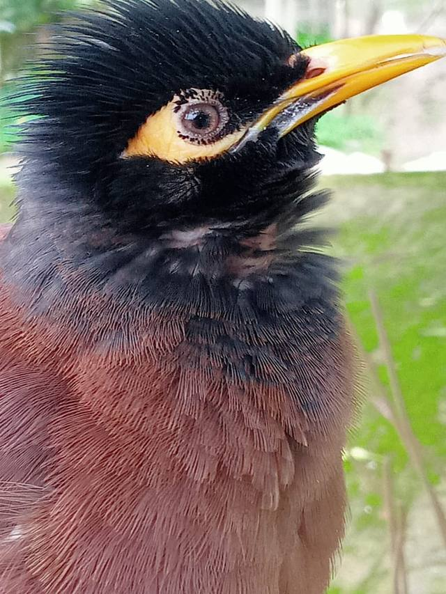
  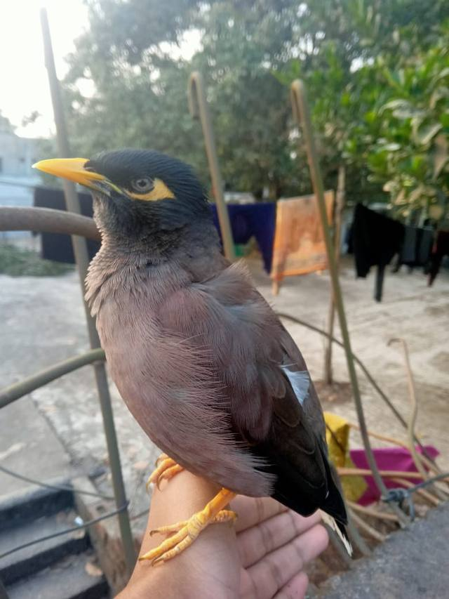
</p>
<p align="center">
  
  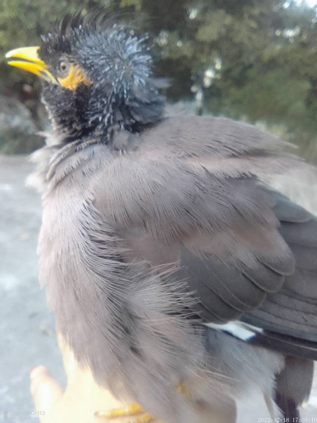
  
</p>

<p align="center"><em>In a tree. On a post. Beak and eye-patch. On a hand.<br>December 2022. His head after the injury, where the feathers fell out. December 2022.</em></p>

Photographs 5, 6, and 7 carry a December 2022 date from the camera. The photographs are already the compressed files in `assets/brand/photos`.

## Features

<table>
  <tr>
    <td width="33%" valign="top"><strong>One frame</strong><br>Tabs, the toolbar, the address bar, bookmarks, and the status bubble are shared by both desktop editions.</td>
    <td width="33%" valign="top"><strong>Your pages</strong><br>Settings, site settings, history, downloads, bookmarks, extensions, and the new tab live at <code>mithu://</code> and stay on this computer.</td>
    <td width="33%" valign="top"><strong>Own mark</strong><br>A myna, a blue globe, and an orange ring. The window does not use another browser's name or logo.</td>
  </tr>
  <tr>
    <td valign="top"><strong>Sharp at any scale</strong><br>The frame snaps to whole pixels at 100%, 125%, 150%, and 200%.</td>
    <td valign="top"><strong>Search you choose</strong><br>The address bar uses DuckDuckGo, Bing, or Wikipedia. A hostname opens as HTTPS.</td>
    <td valign="top"><strong>Light or dark</strong><br>Theme, font size, zoom, the home button, and the bookmarks bar are saved and applied.</td>
  </tr>
</table>

Keyboard: Enter submits the address bar. Alt+Left and Alt+Right walk history. Ctrl+L focuses the address bar, Ctrl+T opens a tab, Ctrl+W closes one, Ctrl+Tab cycles tabs, Ctrl+R reloads, Ctrl+F finds in the page, Ctrl+B toggles the bookmarks bar, Ctrl+D bookmarks the page, Ctrl+H opens history, Ctrl+J opens downloads, and Ctrl+Shift+N opens a private window.

## Editions

| | Mithu | Mithu Lite |
| --- | --- | --- |
| Binary | `mithu` | `mithu-lite` |
| Engine | [Servo](https://github.com/servo/servo), linked from `third_party/servo` | The operating-system web view through [`wry`](https://github.com/tauri-apps/wry): WebKitGTK, WKWebView, or WebView2 |
| Disk | about 96 MB | about 5 MB |
| about:blank RAM | 361 MB RSS, one process | UI about 353 MB RSS, plus WebKit's web and network processes |
| Choose it when | You want Servo in-process | You want a small binary and today's sites |
| Build | Compiles Servo. The submodule is required | Does not compile Servo. The submodule still has to be on disk so Cargo can resolve the workspace |

Those sizes are from Linux x86_64 release builds (`opt-level = "z"`, thin LTO, stripped). On that machine, Lite loaded example.com in 846 ms, English Wikipedia in 1.1–1.4 s, GitHub in 2.0–2.1 s, YouTube's logged-out home in 3.5 s, and BBC in 1.2 s. Servo still drops some images, and video sites that need a proprietary codec do not play.

## Screenshots

<p align="center">
  
</p>

<p align="center"><em>Mithu Lite on English Wikipedia, 1280×800, Linux.</em></p>

<p align="center">
  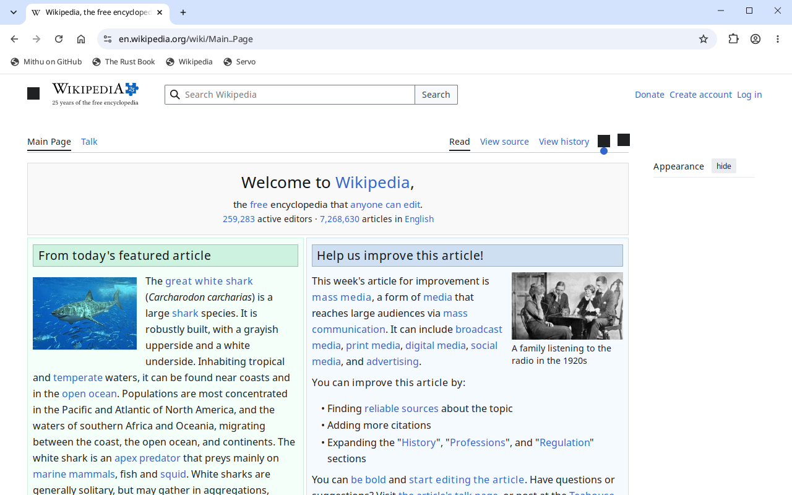
  
</p>
<p align="center">
  
  
</p>

<p align="center"><em>Same Chromium-style frame on Wikipedia, GitHub, and the new tab. Servo still drops some images on Wikipedia.</em></p>

The internal pages use the same layout in light and dark.

<p align="center">
  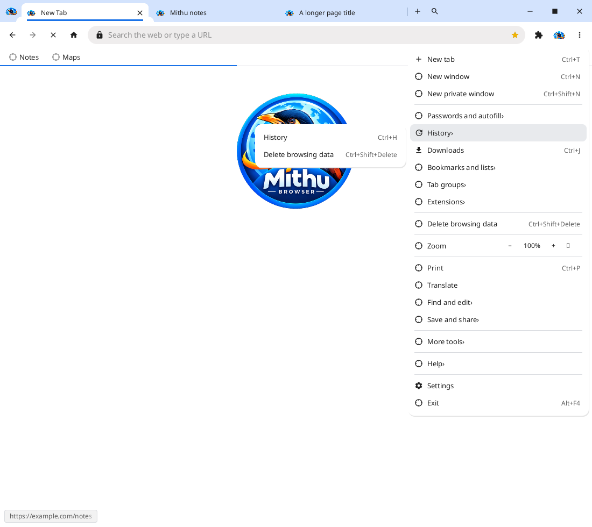
  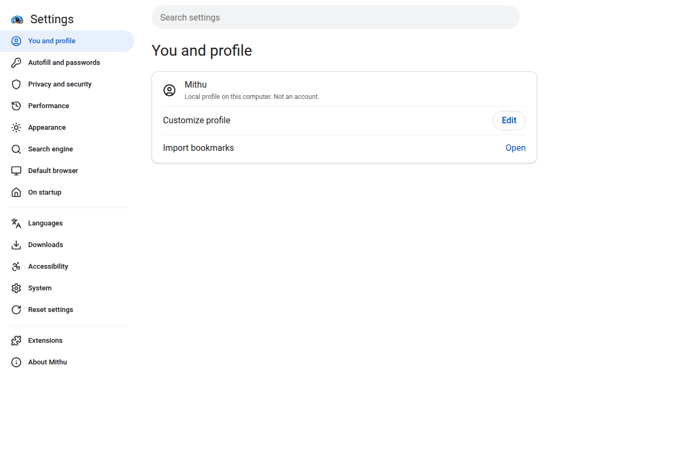
</p>
<p align="center">
  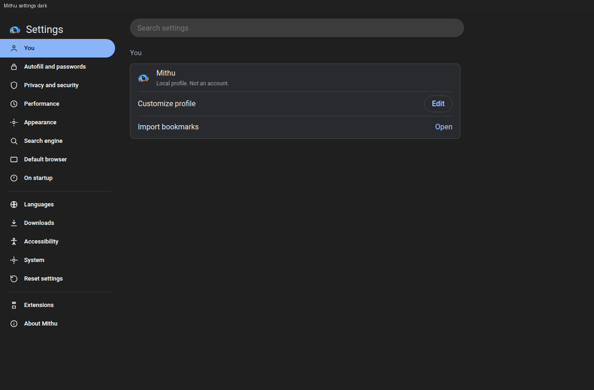
  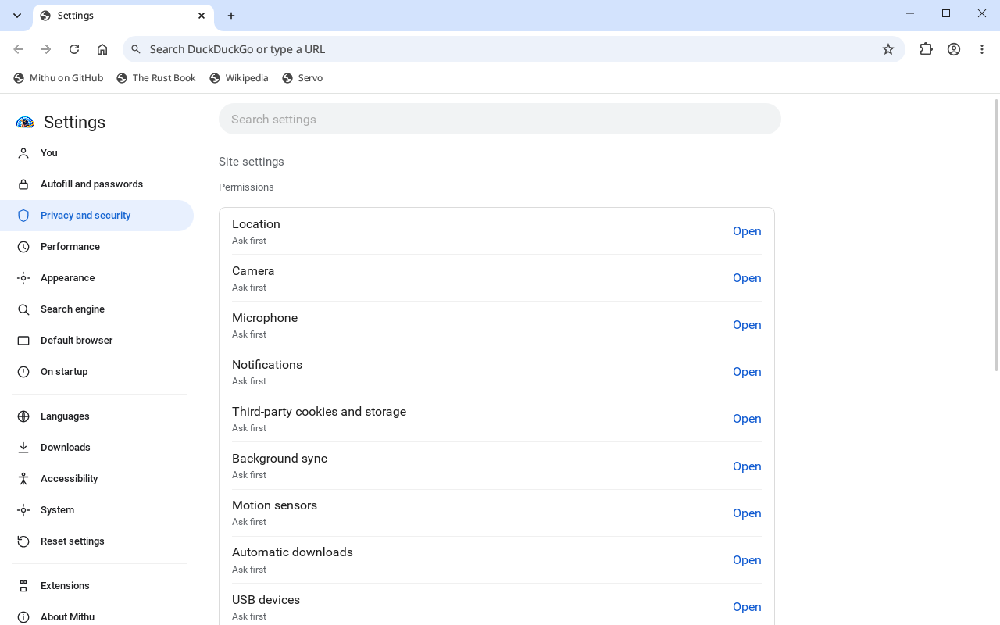
</p>
<p align="center">
  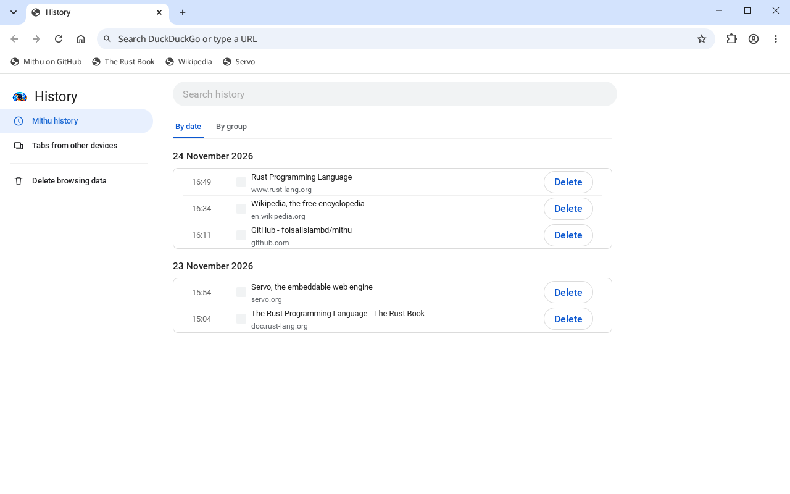
  
</p>
<p align="center">
  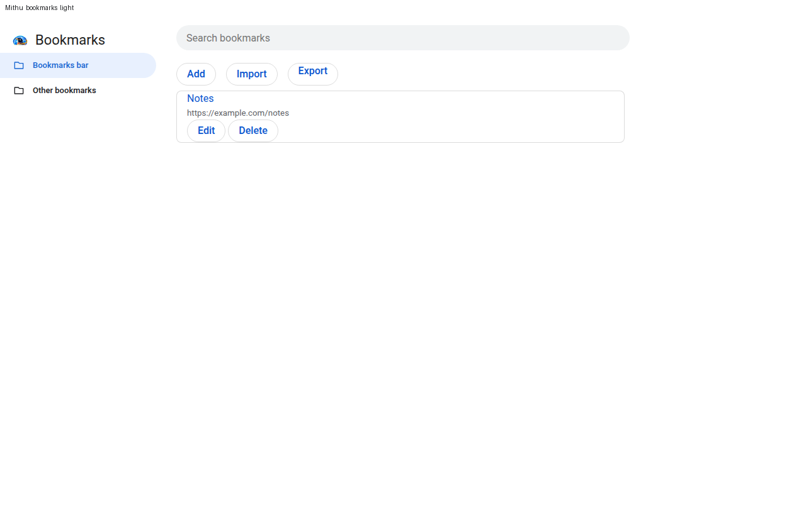
</p>

<p align="center">
  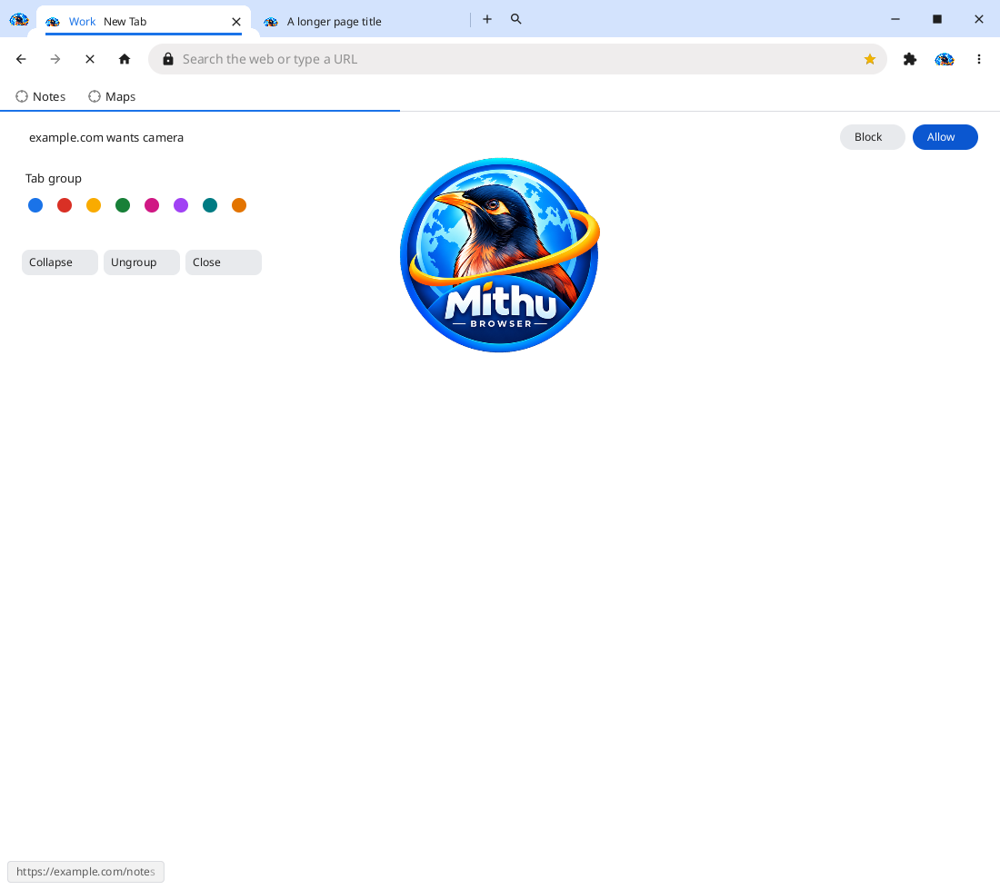
</p>

<p align="center"><em>App menu, settings, site settings, history, downloads, and bookmarks. The last picture is a tab group named Work, its editor, and a camera prompt.</em></p>

## Download

Published desktop builds are on [GitHub Releases](https://github.com/foisalislambd/mithu/releases). The newest published tag is [v0.1.9](https://github.com/foisalislambd/mithu/releases/tag/v0.1.9). This tree is 0.2.0, so the next release is published after that version reaches `main`. Each release includes `SHA256SUMS`. The sums below belong to v0.1.5 only.

| Platform | Mithu | Mithu Lite |
| --- | --- | --- |
| Linux x86_64 | `mithu-linux-x64` | `mithu-lite-linux-x64` |
| macOS | `mithu-macos` | `mithu-lite-macos` |
| Windows x64 | `mithu-windows-x64.zip` | `mithu-lite-windows-x64.exe` |

From the directory that contains the downloaded files and `SHA256SUMS`:

```bash
sha256sum -c SHA256SUMS
```

On Windows, `Get-FileHash` prints the same digest. v0.1.5:

```text
820b04c4ce796237a0f17825b6cb66a2028b3b7a7e6d3f1cb632d70607b57e4a  mithu-linux-x64
9bc119f7c9c10456d78327575da2498a80aea64ecac895b2e86f73953cef3ba8  mithu-lite-linux-x64
972cf7209ef1d712d3fa057788320d8be08a9dfe8851264bf49d80286d176524  mithu-lite-macos
78d0646e68f11be83b561bf3cd3938234d2bf1b6176d20e9b2804770d696edef  mithu-lite-windows-x64.exe
f2abbae5c24adc6575cd4924fde8e08fb78c3aef031a18c64055b8b7b2abd202  mithu-macos
cd928ca784f7eedbbd0b24ed451c90a672ff3d1ebe37a25ec39acf22cf882400  mithu-windows-x64.zip
```

Mark the Linux and macOS files executable (`chmod +x`). On Linux, Lite needs WebKitGTK 4.1 (`libwebkit2gtk-4.1-0`) and `GDK_BACKEND=x11`. Windows Lite needs the WebView2 runtime, which current Windows already includes.

`mithu-windows-x64.zip` holds `mithu.exe`, the Visual C++ runtime DLLs it links (`VCRUNTIME140.dll`, `VCRUNTIME140_1.dll`, `MSVCP140.dll`), ANGLE (`libEGL.dll` and `libGLESv2.dll`), and a short readme. The page is drawn through ANGLE, because raw WGL needs `WGL_NV_DX_interop`. Set `ANGLE_DEFAULT_PLATFORM=warp` for software rendering. Servo's resources are compiled into the executable. Unzip the folder and run `mithu.exe` from that folder.

The release builds of `mithu.exe` and `mithu-lite.exe` are Windows GUI programs, so opening one does not create a terminal. `--version` and `--smoke-test` still print when you start them from a console. A fatal error is appended to `%LOCALAPPDATA%\Mithu\mithu.log` and shown in a message box. The binaries are not code-signed. Windows SmartScreen warns on a new unsigned download because of Mark-of-the-Web, not because a scanner found a payload. If the Windows window closes at once, the reason is in that log.

Phone builds are not in the release. See [Mobile](#mobile).

## Build

Rust stable is pinned in `rust-toolchain.toml`.

**Lite, Linux:** `libwebkit2gtk-4.1-dev`, `libgtk-3-dev`, `libsoup-3.0-dev`. Run with `GDK_BACKEND=x11`.

**Full Mithu, Linux**, also needs Servo's libraries:

```bash
sudo apt-get install -y build-essential cmake pkg-config python3 gperf \
  libclang-dev libssl-dev libfontconfig1-dev libfreetype-dev \
  libglib2.0-dev libgtk-3-dev libunwind-dev \
  gstreamer1.0-plugins-good libgstreamer1.0-dev libgstreamer-plugins-base1.0-dev
```

macOS needs Xcode Command Line Tools. Windows needs Visual Studio C++. Full Mithu on Windows also needs the toolchain Servo documents after the submodule is present.

```bash
git clone --depth 1 https://github.com/foisalislambd/mithu.git
cd mithu
git submodule update --init --depth 1 third_party/servo

cargo run -p mithu-lite
cargo run -p mithu
tools/package.sh lite
tools/package.sh full
cargo test --workspace
```

`tools/package.sh` runs `tools/version.py sync` first, so the binaries follow `VERSION.md`. On Windows, `tools/package-windows.ps1` does the packaging.

## Mobile

The phone projects are in the tree. They are not published as release artifacts, and neither one links Servo yet. Both open the shared new-tab page in the system web view. `tools/install-mobile-assets.sh` writes that page, the logo, and the fonts at build time. Those files are not committed.

| | Android | iOS |
| --- | --- | --- |
| Path | `mobile/android` | `mobile/ios` |
| What builds | A Gradle app, flavors `lite` and `servo` | `MithuLite.swift`, a WKWebView controller, plus `Info.plist` |
| App id | `org.mithu.lite` and `org.mithu.servo` | `org.mithu.lite` |
| Engine today | Android WebView | WKWebView |

Android uses compile SDK 35 and min SDK 26. `versionName` and `versionCode` follow `VERSION.md` (0.1.7 is code 1007). CI builds a debug APK, which the Android Gradle Plugin signs with the debug keystore (`gradle assembleDebug` in `mobile/android`). `tools/ios-unsigned.sh` compiles `MithuLite.swift` into an unsigned `MithuLite.app` with the iOS SDK. That is not an App Store archive. Icons for both platforms are in `assets/android`, `assets/android-lite`, and `assets/ios`.

Desktop Linux, macOS, and Windows are what the GitHub releases ship.

## Project structure

| Path | What it is |
| --- | --- |
| `crates/ui` | Shared frame, `mithu://` pages, menus, and the mark |
| `crates/text` | Noto Sans and Noto Sans Bengali, drawn in the frame |
| `crates/shell` | Servo tabs under that frame |
| `crates/mobile` | Shared new-tab document for the phone shells |
| `crates/host` | Win32 console attach. The only crate that allows `unsafe` |
| `app/mithu` | Full desktop window |
| `app/mithu-lite` | Lite desktop window, one OS web view per tab |
| `mobile/android`, `mobile/ios` | Phone projects |
| `third_party/servo` | Servo submodule. Not compiled into Lite or the phone apps |
| `VERSION.md` | The only version to edit |
| `assets/brand` | Logo, marks, icons, and the photographs |

Page text uses the Roboto files in `assets/fonts/roboto`. Toolbar icons are filled Material paths under `crates/ui/icons`.

## Releases

The version is the first line of [VERSION.md](VERSION.md). Right now that line is `0.2.0`. That file is the only place to change it.

`python3 tools/version.py sync` copies the line into `[workspace.package] version`, the workspace packages in `Cargo.lock`, the version badge at the top of this file, and, when those projects are in the tree, Android `versionName` / `versionCode` and iOS `CFBundleShortVersionString`, `CFBundleVersion`, `MARKETING_VERSION`, and `CURRENT_PROJECT_VERSION`. The numeric code is `major * 1000000 + minor * 1000 + patch` (0.1.7 is 1007). `python3 tools/version.py check` prints any files that still differ and exits 0. `python3 tools/version.py set 0.1.7` writes `VERSION.md` and syncs.

Pushing `main` publishes a GitHub Release only when that version is strictly greater than the newest `v*` tag. Each build runs `sync` before compiling.

## Roadmap

1. Broader Servo page fidelity, including images and sites that need a media codec.
2. Saving a file a site starts, in the Servo edition. Save page already writes into the downloads folder.
3. Lite on Wayland.
4. Phone builds in a release, and a Servo edition that is actually Servo on Android. The projects under `mobile/` are the start, not that build.
5. Code signing for the desktop downloads.

[docs/ROADMAP.md](docs/ROADMAP.md) is the older note from the in-tree engine. [docs/ARCHITECTURE.md](docs/ARCHITECTURE.md) describes the Servo shell.

Engine progress (Lintel, Reed, Tercel, Gable, Purlin, Transom, Eave, Wainscot) is measured by upstream test conformance, not by headline estimates; see [docs/MEASURING.md](docs/MEASURING.md).

## Contributing

Issues and pull requests go to [github.com/foisalislambd/mithu](https://github.com/foisalislambd/mithu). Read [CONTRIBUTING.md](CONTRIBUTING.md) and [CODE_OF_CONDUCT.md](CODE_OF_CONDUCT.md). Report a security problem through [SECURITY.md](SECURITY.md).

The interface stays in English. Workspace crates forbid `unsafe` code, except `crates/host`, which is the Win32 console attach. Do not weaken TLS hostname checks.

## License

Licensed under the Apache License, Version 2.0. See [LICENSE](LICENSE) and [NOTICE](NOTICE). Upstream notices in [THIRD_PARTY_NOTICES.md](THIRD_PARTY_NOTICES.md).

The "Mithu" name and logo are not licensed under Apache-2.0 (or any other software license). You may not use them to endorse or promote a derived product without permission.

`third_party/servo` is [Servo](https://github.com/servo/servo) and stays under MPL-2.0; it is not relicensed. The Lintel, Reed, Tercel, Gable, Purlin, Transom, Eave, and Wainscot engines are also Apache-2.0.
